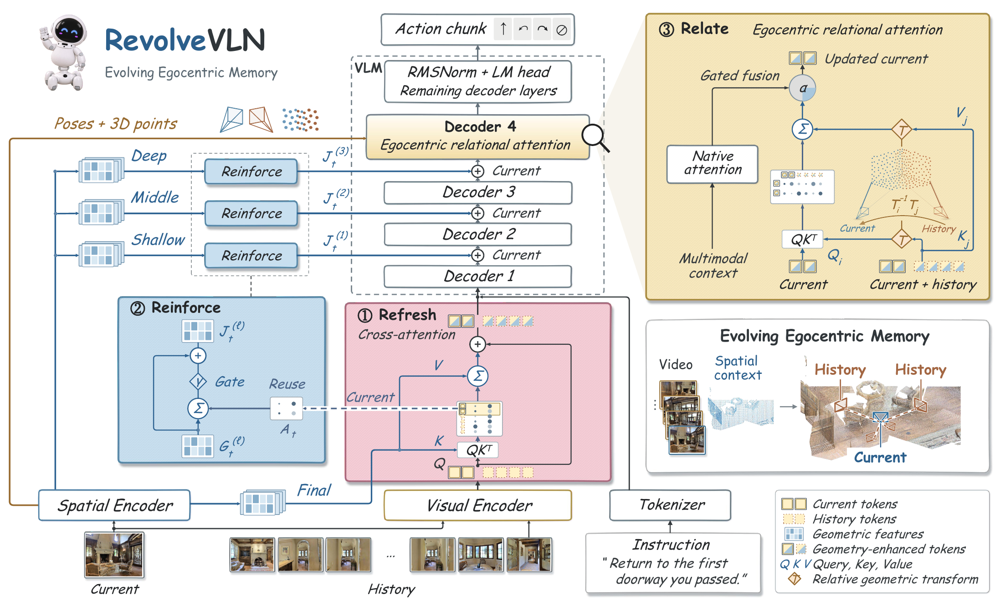
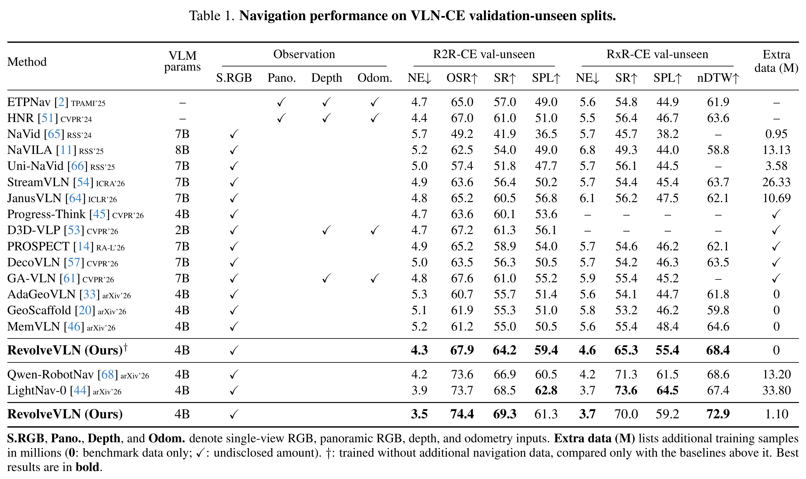
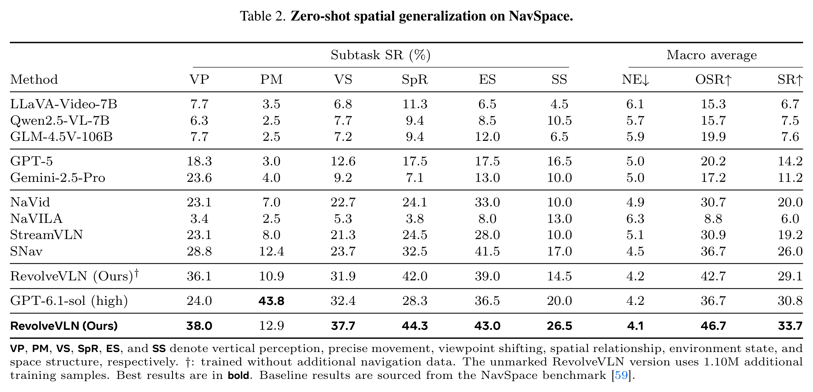
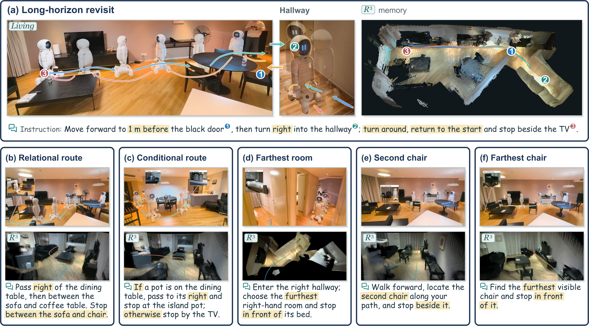

<h1 align="center">RevolveVLN: Evolving Egocentric Memory towards Spatial Intelligence in Vision-Language Navigation</h1>

<p align="center">
  
  &nbsp;
  <a href="https://www.youtube.com/watch?v=F9MoMPJtmbY"></a>
  &nbsp;
  <a href="https://yilinj10.github.io/RevolveVLN/"></a>
  &nbsp;
  <a href="https://huggingface.co/yilin-jia/RevolveVLN"></a>
  &nbsp;
  <a href="https://github.com/YilinJ10/RevolveVLN"></a>
</p>

RevolveVLN builds **Evolving Egocentric Memory** from a stream of monocular RGB images. **Refresh** updates the visual features of past and current views with newly observed geometry. **Reinforce** reuses the current view’s attention weights to bring geometry into the early decoder layers. **Relate** uses relative camera poses and 3D points to connect remembered views to the current one before the model predicts its next actions.



## Navigation results

With benchmark training data alone, RevolveVLN reaches **64.2%** success on R2R-CE and **65.3%** on RxR-CE. With 1.10M additional training samples, the corresponding success rates are **69.3%** and **70.0%** on the validation-unseen splits.

[](results/README.md#vln-ce)

On NavSpace, RevolveVLN achieves **29.1% macro success** with benchmark training data alone and **33.7%** with 1.10M additional samples. Both results are zero-shot averages across six spatial tasks.

<p align="center">
  <a href="results/table-2-navspace.png"></a>
</p>

## Real-world navigation

[](figures/real-world-tasks.webp)

## TODO

- [ ] Release checkpoints ([Hugging Face](https://huggingface.co/yilin-jia/RevolveVLN)).
- [ ] Release evaluation code.
- [ ] Release training code.

## Citation

If you find RevolveVLN helpful for your research, please consider giving us a star 🌟 and citing it:

```bibtex
@misc{jia_revolvevln,
  title  = {{RevolveVLN}: Evolving Egocentric Memory towards Spatial Intelligence
            in Vision-Language Navigation},
  author = {Jia, Yilin and Zhong, Yangyi and Yao, Hongze and Liu, Mai and
            Lv, Xiaohui and Tao, Shuai and Liu, Wulong and Li, Rong and
            Gong, Zeying and Hu, Tianshuai and Fan, Junfeng and Liang, Junwei}
}
```
