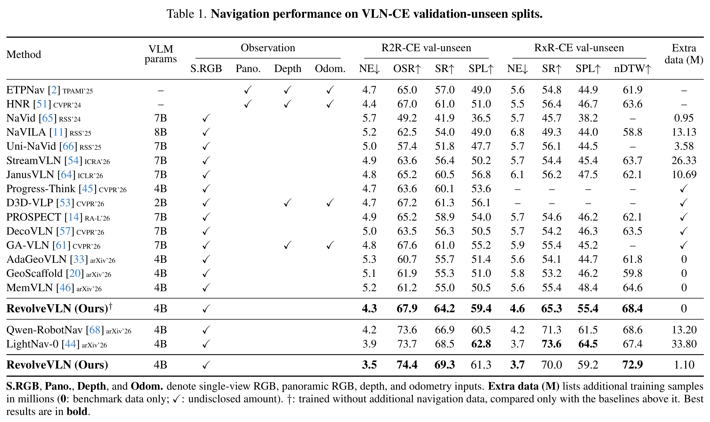
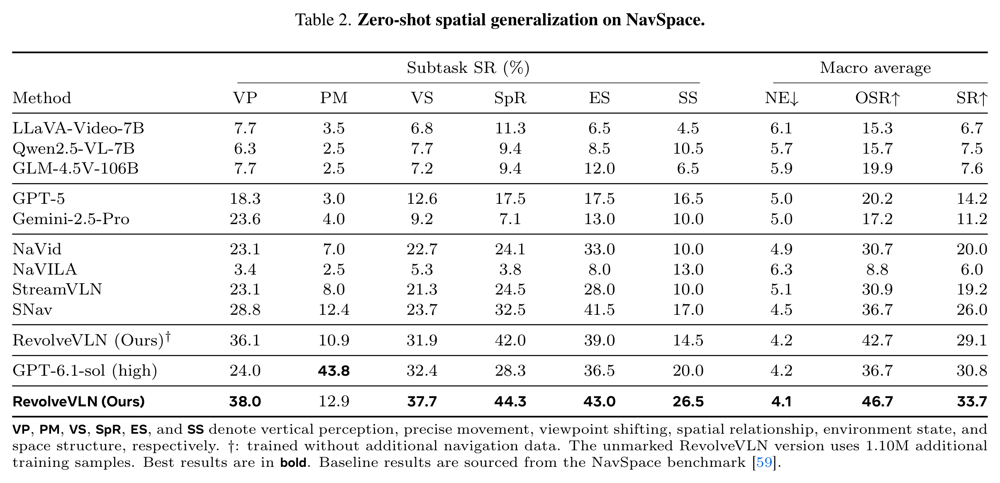
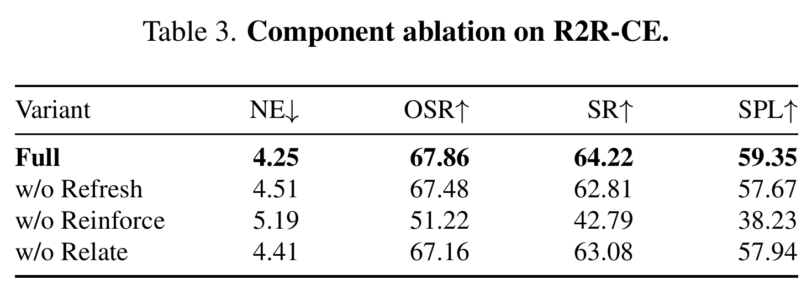
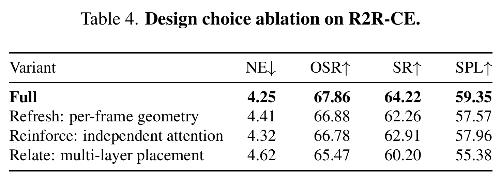

# Tables from the paper

[Project overview](../README.md)

These are Tables 1–4 from the main paper. Open an image for the printed table, including its footnotes, or expand the text version to copy individual values.

## VLN-CE

Copyable table

| Method | VLM params | S.RGB | Pano. | Depth | Odom. | R2R-CE NE ↓ | R2R-CE OSR ↑ | R2R-CE SR ↑ | R2R-CE SPL ↑ | RxR-CE NE ↓ | RxR-CE SR ↑ | RxR-CE SPL ↑ | RxR-CE nDTW ↑ | Extra data (M) |
| :--- | :---: | :---: | :---: | :---: | :---: | ---: | ---: | ---: | ---: | ---: | ---: | ---: | ---: | ---: |
| ETPNav [2] TPAMI’25 | – |  | ✓ | ✓ | ✓ | 4.7 | 65.0 | 57.0 | 49.0 | 5.6 | 54.8 | 44.9 | 61.9 | – |
| HNR [51] CVPR’24 | – |  | ✓ | ✓ | ✓ | 4.4 | 67.0 | 61.0 | 51.0 | 5.5 | 56.4 | 46.7 | 63.6 | – |
| NaVid [65] RSS’24 | 7B | ✓ |  |  |  | 5.7 | 49.2 | 41.9 | 36.5 | 5.7 | 45.7 | 38.2 | – | 0.95 |
| NaVILA [11] RSS’25 | 8B | ✓ |  |  |  | 5.2 | 62.5 | 54.0 | 49.0 | 6.8 | 49.3 | 44.0 | 58.8 | 13.13 |
| Uni-NaVid [66] RSS’25 | 7B | ✓ |  |  |  | 5.0 | 57.4 | 51.8 | 47.7 | 5.7 | 56.1 | 44.5 | – | 3.58 |
| StreamVLN [54] ICRA’26 | 7B | ✓ |  |  |  | 4.9 | 63.6 | 56.4 | 50.2 | 5.7 | 54.4 | 45.4 | 63.7 | 26.33 |
| JanusVLN [64] ICLR’26 | 7B | ✓ |  |  |  | 4.8 | 65.2 | 60.5 | 56.8 | 6.1 | 56.2 | 47.5 | 62.1 | 10.69 |
| Progress-Think [45] CVPR’26 | 4B | ✓ |  |  |  | 4.7 | 63.6 | 60.1 | 53.6 | – | – | – | – | ✓ |
| D3D-VLP [53] CVPR’26 | 2B | ✓ |  | ✓ | ✓ | 4.7 | 67.2 | 61.3 | 56.1 | – | – | – | – | ✓ |
| PROSPECT [14] RA-L’26 | 7B | ✓ |  |  |  | 4.9 | 65.2 | 58.9 | 54.0 | 5.7 | 54.6 | 46.2 | 62.1 | ✓ |
| DecoVLN [57] CVPR’26 | 7B | ✓ |  |  |  | 5.0 | 63.5 | 56.3 | 50.5 | 5.7 | 54.2 | 46.3 | 63.5 | ✓ |
| GA-VLN [61] CVPR’26 | 7B | ✓ |  | ✓ | ✓ | 4.8 | 67.6 | 61.0 | 55.2 | 5.9 | 55.4 | 45.2 | – | ✓ |
| AdaGeoVLN [33] arXiv’26 | 4B | ✓ |  |  |  | 5.3 | 60.7 | 55.7 | 51.4 | 5.6 | 54.1 | 44.7 | 61.8 | 0 |
| GeoScaffold [20] arXiv’26 | 4B | ✓ |  |  |  | 5.1 | 61.9 | 55.3 | 51.0 | 5.8 | 53.2 | 46.2 | 59.8 | 0 |
| MemVLN [46] arXiv’26 | 4B | ✓ |  |  |  | 5.2 | 61.2 | 55.0 | 50.5 | 5.6 | 55.4 | 48.4 | 64.6 | 0 |
| **RevolveVLN (Ours)†** | 4B | ✓ |  |  |  | **4.3** | **67.9** | **64.2** | **59.4** | **4.6** | **65.3** | **55.4** | **68.4** | 0 |
| Qwen-RobotNav [68] arXiv’26 | 4B | ✓ |  |  |  | 4.2 | 73.6 | 66.9 | 60.5 | 4.2 | 71.3 | 61.5 | 68.6 | 13.20 |
| LightNav-0 [44] arXiv’26 | 4B | ✓ |  |  |  | 3.9 | 73.7 | 68.5 | **62.8** | 3.7 | **73.6** | **64.5** | 67.4 | 33.80 |
| **RevolveVLN (Ours)** | 4B | ✓ |  |  |  | **3.5** | **74.4** | **69.3** | 61.3 | **3.7** | 70.0 | 59.2 | **72.9** | 1.10 |

**S.RGB**, **Pano.**, **Depth**, and **Odom.** denote single-view RGB, panoramic RGB, depth, and odometry inputs. **Extra data (M)** gives additional training samples in millions. A zero denotes benchmark data only. A check mark in this column denotes an undisclosed amount. The dagger (†) marks the model trained without additional navigation data, which the paper compares with the baselines above it. Boldface follows the paper.

## NavSpace

  

Copyable table

| Method | VP | PM | VS | SpR | ES | SS | Macro NE ↓ | Macro OSR ↑ | Macro SR ↑ |
| :--- | ---: | ---: | ---: | ---: | ---: | ---: | ---: | ---: | ---: |
| LLaVA-Video-7B | 7.7 | 3.5 | 6.8 | 11.3 | 6.5 | 4.5 | 6.1 | 15.3 | 6.7 |
| Qwen2.5-VL-7B | 6.3 | 2.5 | 7.7 | 9.4 | 8.5 | 10.5 | 5.7 | 15.7 | 7.5 |
| GLM-4.5V-106B | 7.7 | 2.5 | 7.2 | 9.4 | 12.0 | 6.5 | 5.9 | 19.9 | 7.6 |
| GPT-5 | 18.3 | 3.0 | 12.6 | 17.5 | 17.5 | 16.5 | 5.0 | 20.2 | 14.2 |
| Gemini-2.5-Pro | 23.6 | 4.0 | 9.2 | 7.1 | 13.0 | 10.0 | 5.0 | 17.2 | 11.2 |
| NaVid | 23.1 | 7.0 | 22.7 | 24.1 | 33.0 | 10.0 | 4.9 | 30.7 | 20.0 |
| NaVILA | 3.4 | 2.5 | 5.3 | 3.8 | 8.0 | 13.0 | 6.3 | 8.8 | 6.0 |
| StreamVLN | 23.1 | 8.0 | 21.3 | 24.5 | 28.0 | 10.0 | 5.1 | 30.9 | 19.2 |
| SNav | 28.8 | 12.4 | 23.7 | 32.5 | 41.5 | 17.0 | 4.5 | 36.7 | 26.0 |
| RevolveVLN (Ours)† | 36.1 | 10.9 | 31.9 | 42.0 | 39.0 | 14.5 | 4.2 | 42.7 | 29.1 |
| GPT-6.1-sol (high) | 24.0 | **43.8** | 32.4 | 28.3 | 36.5 | 20.0 | 4.2 | 36.7 | 30.8 |
| **RevolveVLN (Ours)** | **38.0** | 12.9 | **37.7** | **44.3** | **43.0** | **26.5** | **4.1** | **46.7** | **33.7** |

The six subtask columns give success rates (%). **VP** denotes vertical perception, **PM** precise movement, **VS** viewpoint shifting, **SpR** spatial relationship, **ES** environment state, and **SS** space structure. Macro averages weight the six categories equally. The dagger (†) marks RevolveVLN trained without additional navigation data. The unmarked RevolveVLN uses 1.10M additional training samples. Bold values indicate the best result in each column. Baseline results are from the NavSpace benchmark [59].

## Component ablation

Copyable table

| Variant | NE ↓ | OSR ↑ | SR ↑ | SPL ↑ |
| :--- | ---: | ---: | ---: | ---: |
| **Full** | **4.25** | **67.86** | **64.22** | **59.35** |
| w/o Refresh | 4.51 | 67.48 | 62.81 | 57.67 |
| w/o Reinforce | 5.19 | 51.22 | 42.79 | 38.23 |
| w/o Relate | 4.41 | 67.16 | 63.08 | 57.94 |

## Design choice ablation

Copyable table

| Variant | NE ↓ | OSR ↑ | SR ↑ | SPL ↑ |
| :--- | ---: | ---: | ---: | ---: |
| **Full** | **4.25** | **67.86** | **64.22** | **59.35** |
| Refresh: per-frame geometry | 4.41 | 66.88 | 62.26 | 57.57 |
| Reinforce: independent attention | 4.32 | 66.78 | 62.91 | 57.96 |
| Relate: multi-layer placement | 4.62 | 65.47 | 60.20 | 55.38 |

